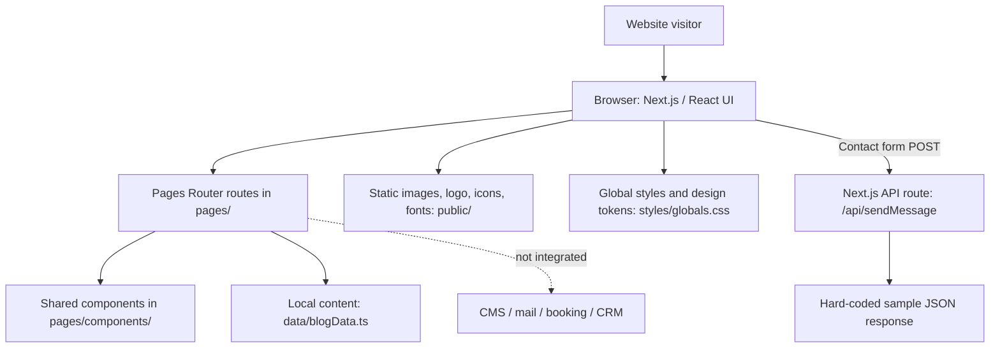

# Beatrix Website — Project Handover

**Audience:** incoming developers, designers, content editors, and project
owners  
**Project repository:** `AfubeAngel/Beatrix-website`  
**Application:** Next.js Pages Router website for Beatrix / Health Coach Abby

This document describes the code currently in the repository and separates
implemented behavior from work that still needs to be delivered. It is not a
claim that the public production site, email delivery, booking, or CMS has
already been configured.

## 1. Executive handover

The repository is a React website built with the Next.js Pages Router,
TypeScript, and Tailwind CSS. Its pages and most marketing content are maintained in source
files; image assets are stored in `public/`. There is no configured database,
external CMS, email service, scheduling provider, or CRM in the codebase.

| Area | Current implementation | Handover status |
| --- | --- | --- |
| Public website | Home, About, Blog, Contact, Resources, and consultation-related routes | Source is available in this repository; confirm production URL and hosting account with the owner |
| Brand identity | `public/Beatrix-logo.svg`, `public/favicon.ico`, and color/font styles | A single logo asset is used in the navbar/footer; no replacement logo or brand guide is present |
| About/trainer imagery | About photos and a rotating training/endorsement card strip | Images and names are hard-coded; verify portrait/name attribution and replace with approved assets |
| Blog | Local TypeScript content data and dynamic article route | No CMS; posts are not currently editor-managed |
| FAQs | Four static entries in the Contact FAQ component, also included on consultation pages | Exact current copy is recorded below; business owner should approve it |
| Contact form | Browser form posts to `/api/sendMessage` | API currently returns a hard-coded sample response; it does not send/store the message |
| Health assessments | First-time men/women forms keep data in browser state and log on submit | No service receives or stores submissions |
| Follow-up | Form shows a simulated success after a delay | No service receives or stores submissions |
| Appointment selection | Date/time picker page logs selected values | No booking, availability check, or confirmation is connected |

**Critical launch caveat:** the health assessments request sensitive health
information and promise confidentiality in the UI, but the project has no secure
submission, storage, access-control, or retention implementation. Do not treat
these forms as an operational confidential intake process until an approved
backend and privacy process are implemented and tested.

## 2. Source copy and local setup

The full source copy is the Git repository; no separate website export or
database dump is part of this project. Clone the repository and check out the
approved deployment branch/commit:

```bash
git clone https://github.com/AfubeAngel/Beatrix-website.git
cd Beatrix-website
npm ci
npm run dev
```

Open `http://localhost:3000`. To produce and serve a production build:

```bash
npm run build
npm start
```

Available package scripts:

| Script | Command | Purpose |
| --- | --- | --- |
| `dev` | `next dev` | Local development server |
| `build` | `next build` | Production build |
| `start` | `next start` | Serve a built application |
| `lint` | `next lint` | Run the configured Next.js lint command |

There is a committed `package-lock.json`; use `npm ci` to install its locked
dependency tree. There are no test scripts in `package.json`. The project uses
Next.js 15.2.1, React 19, TypeScript 5, Tailwind CSS 4, React Hook Form,
React Select, Day.js, MUI date picker packages, Splide, and Zustand.

No environment-variable template, deployment workflow, hosting configuration,
or credentials are included in the repository. Confirm hosting, domain/DNS,
deployment branch, runtime settings, monitoring, and account ownership directly
with the project owner. Never commit production credentials or real form data.

## 3. Architecture



### Application composition

- `pages/` maps files directly to URL routes (Pages Router).
- `pages/_app.tsx` imports global styles, applies the DM Sans font variable,
  renders each page, includes the shared footer, and updates the Zustand
  navigation store when routes change.
- Individual pages generally render `Navbar` and then page sections from
  `pages/components/`. The global footer is rendered by `_app.tsx`; page
  components should not add another shared footer unless intentionally
  changing that behavior.
- `pages/_document.tsx` supplies the HTML document shell and `lang="en"`.
- `/public/...` paths refer to files under `public/`; Next Image is used for
  most images.
- Blog post data is imported directly into both listing and article pages.
- The only non-placeholder API route is `pages/api/sendMessage.ts`, which
  currently responds with fixed sample data. The `pages/api/hello.ts` route is
  the starter/demo endpoint.
- There is no persistence layer or external integration shown in this source.

### Main source areas

| Path | Responsibility |
| --- | --- |
| `pages/` | Route entry points |
| `pages/components/home/` | Home page sections |
| `pages/components/about/` | About page sections, including trainer carousel |
| `pages/components/contact/` | Contact details, contact form, FAQ |
| `pages/components/forms/` | Shared input, select, date/time, and breadcrumb UI |
| `pages/components/resources/` | Resources page sections |
| `data/blogData.ts` | Blog article objects and content block types |
| `stores/useNavigationStore.ts` | Zustand navigation state |
| `styles/globals.css` | Global CSS, brand color variables, utility classes |
| `public/` | Logo, page photography, icons, fonts, and other static assets |

## 4. Route inventory

| URL | Source | Purpose / current notes |
| --- | --- | --- |
| `/` | `pages/index.tsx` | Home page: hero, services/approach, testimonials, static blog teaser, signup modal |
| `/about` | `pages/about.tsx` | Coach introduction, journey, trainer/endorsement strip, consultation CTA |
| `/contact` | `pages/contact.tsx` | Contact form, contact details, FAQs |
| `/blog` | `pages/blog/index.tsx` | Featured article area and cards from local post data |
| `/blog/[slug]` | `pages/blog/[slug].tsx` | Article renderer using local post data |
| `/resources` | `pages/resources.tsx` | Resources content page; not linked in current navbar (its navbar links are commented out) |
| `/consultation` | `pages/consultation.tsx` | Choose first-time or follow-up consultation |
| `/firstconsultation` | `pages/firstconsultation.tsx` | Choose women’s or men’s first-time assessment |
| `/womenhealth` | `pages/womenhealth.tsx` | Women’s health history assessment |
| `/menhealth` | `pages/menhealth.tsx` | Men’s health history assessment |
| `/followup` | `pages/followup.tsx` | Follow-up assessment form |
| `/consultationform` | `pages/consultationform.tsx` | Date/time appointment selection; submit is not connected to booking |
| `/api/sendMessage` | `pages/api/sendMessage.ts` | Contact API placeholder; currently returns static JSON |
| `/api/hello` | `pages/api/hello.ts` | Starter/demo API route |

The primary navigation exposes Home, About, Blog, and Contact. The Contact
button in the navbar routes to `/contact`; other consultation links appear in
page CTAs and the consultation selection flow.

## 5. Brand identity, logo, and assets

### Current implementation

- The same SVG, `public/Beatrix-logo.svg`, is used for the desktop/mobile
  navbar and footer. The favicon is a separate `public/favicon.ico`.
- DM Sans is configured in `pages/_app.tsx`; copies of the font are also
  present under `public/fonts/DM_Sans/`. Keep font licensing/attribution
  materials in place.
- Brand color variables live in `styles/globals.css`:

  | Token | Value |
  | --- | --- |
  | Primary main | `#4A7A8C` |
  | Primary hover | `#316070` |
  | Primary light | `#E3EDDA` |
  | Primary lighter | `#F2F7EE` |
  | Secondary main | `#EAEDF9` |
  | Default text | `#6D6D6D` |

  Several components also use literal color values; a full brand refresh should
  search for these before considering the update complete.

### Logo/identity handoff checklist

1. Obtain the approved logo source files and brand guide from the owner
   (primary, compact/mobile, light-on-dark, and favicon variants as applicable).
2. Replace/update `public/Beatrix-logo.svg` and `public/favicon.ico` only with
   approved, web-ready artwork. Confirm the SVG has accessible dimensions and
   a clear viewBox.
3. Check all logo usages in `pages/components/Navbar.tsx` and
   `pages/components/Footer.tsx`; verify mobile and desktop sizing/background
   contrast.
4. Update tokens in `styles/globals.css` and component-level hard-coded colors
   consistently; check focus, hover, contrast, and responsive states.
5. Confirm wordmark/name usage, business contact details, social links, and
   copyright year with the owner; do not infer them from current placeholders.
6. Review favicon/browser tab, social sharing image/metadata (not currently
   configured), and all pages at mobile/tablet/desktop widths.

### Static asset conventions

Use descriptive, lowercase asset names and reference assets as root-relative
paths, for example `/training/coach-name.webp`. Existing About photos include
`public/aboutpage-hero.png` and `public/about-2.png`. Other public assets include
home, approach, blog, resources, and signup images. Preserve an original source
copy and confirm usage/portrait permissions before replacing or publishing
photography.

## 6. About page: trainer image updates

The About page is composed in `pages/about.tsx`; the coach hero image is
`/aboutpage-hero.png`, the journey section uses `/about-2.png`, and the trainer
carousel data is hard-coded in
`pages/components/about/trainings.tsx`.

Current carousel entries and configured images:

| Display name | Caption | Current image |
| --- | --- | --- |
| Susan Blum | Assistant Clinical Professor at Mount Sinai | `/training/geneen.png` |
| Mark Hyman | MD, Founder of The UltraWellness Center | `/training/mark hy.png` |
| Geneen Roth | Bestselling Author on Emotional Eating | `/training/geneen.png` |
| Marion Nestle | PhD, Professor at New York University | `/training/marion.png` |
| Mark Bitmann | Food writer for The New York Times | `/training/mark.png` |

The Susan Blum and Geneen Roth entries share the same configured portrait.
Before updating, have the owner/content team verify each person's name,
credential/caption, portrait, and permission to use it. Replace the image paths
in the `testimonials` data array and add approved files under
`public/training/`. The component uses Next Image with fixed 40×40 dimensions
and an accessible alt string from the person's display name. Check image crop,
legibility, and responsive Splide behavior after replacing.

## 7. Blog content, CMS integration, and management

### Current state

- `data/blogData.ts` is the content source for `/blog` and `/blog/[slug]`.
- Each post has a title, description, slug, image, URL link, date, read time,
  numeric likes/comments, author object, and an array of typed body blocks
  (`h2`, `h3`, `p`).
- The ten current entries in `data/blogData.ts` are:

  | Article | Slug | Date |
  | --- | --- | --- |
  | How to Listen to Your Body: Understanding Hunger, Cravings & Fullness | `listen-to-your-body` | April 10, 2025 |
  | Integrative Nutrition: A New Way of Life | `integrative-nutrition` | April 11, 2025 |
  | How to Successfully Navigate Parties | `how-to-navigate-parties` | April 12, 2025 |
  | Truth Behind Health and Wellness Myths | `truth-behind-health-myths` | April 12, 2025 |
  | Nutrition & Healthy Eating Foods | `nutrition-healthy-eating` | April 12, 2025 |
  | Women’s Health & Hormonal Balance | `womens-health-hormonal-balance` | April 12, 2025 |
  | Mindfulness & Mental Health | `mindfulness-mental-health` | April 12, 2025 |
  | Health Coaching & Personal Growth | `health-coaching-personal-growth` | April 12, 2025 |
  | Meal Prep for a Stress-Free Week | `meal-prep-stress-free-week` | April 12, 2025 |
  | How to Enjoy Food Without Guilt | `how-to-enjoy-food-without-guilt` | April 12, 2025 |
- Article pages find a post by matching `link` to `/blog/${slug}`. Keep the
  `slug` and `link` consistent, and do not change published slugs without a
  redirect plan.
- There is no CMS client, content API, editorial workflow, search index, or
  persistence for engagement data.
- The home and Resources page teaser cards are separately hard-coded in
  `pages/components/home/blogSection.tsx` and
  `pages/components/resources/blogSection.tsx`; they are not generated from
  `blogData.ts` and currently have `#` links.
- The Blog navbar search control only opens a text input; it does not filter
  articles. The featured blog CTA uses `href="#"`. Likes, comments, and sharing
  are display-only/nonfunctional.

### Recommended CMS integration and editorial workflow

The CMS vendor is not specified in the repository; select one with the owner
based on editor experience, cost, image hosting, API availability, draft/preview
needs, and data residency/privacy requirements. Keep the choice explicit
before implementation. A headless CMS is a reasonable model for this
Next.js-based site, but this document does not assume a vendor.

Recommended content model:

| Field | Guidance |
| --- | --- |
| `title` | Required article title |
| `slug` | Required, unique, URL-safe; preserve existing public URLs where possible |
| `excerpt` / description | Short summary for cards and metadata |
| `coverImage` | CMS-managed image with alt text and crop guidance |
| `publishedAt` | Publication date/time and timezone policy |
| `readTime` | Editorial value or derived value; define which source of truth is used |
| `author` | Name, approved portrait, biography |
| `body` | Rich text with supported headings, paragraphs, lists, and image blocks |
| `status` | Draft/published/archived or CMS-native publication state |
| SEO fields | Search title, description, canonical URL, share image |

Suggested implementation sequence:

1. Confirm CMS owner accounts, roles, publication process, domain/API settings,
   and whether preview/draft review is required.
2. Model the existing post content in the CMS; audit current article body text
   and replace repeated/template copy with approved final editorial content.
3. Add a typed CMS client and server-side environment configuration; keep API
   tokens out of client bundles and source control.
4. Map CMS entries into a typed application-level post model. Update the blog
   list, article route, and home/Resources teasers to use the same source.
5. Decide how missing/unknown slugs render (proper 404), how images and alt
   text are validated, and how publish updates/cache revalidation work.
6. Migrate slugs/URLs carefully, set redirects if any change, and test draft,
   publish, update, unpublish, image, and not-found flows before launch.
7. Give editors a short content checklist: accurate claims, approved photos,
   alt text, links, author attribution, proofread copy, and preview before
   publishing.

Do not treat the display-only likes/comments as real interaction metrics. If
engagement is a requirement, define ownership, moderation, data retention, and
spam controls before adding a service.

## 8. FAQs: current website copy

The FAQ list is hard-coded in `pages/components/contact/faq.tsx` and appears on
the Contact page and consultation selection pages. Current entries are:

1. **How long are the sessions?**  
   Initial consultations are 50 minutes and free of charge, allowing us to dive
   deep into your health goals and progress.
2. **Do you offer virtual sessions?**  
   Yes! We offer worldwide virtual consultations.
3. **Do you provide meal plans?**  
   Yes, we customize meal plans based on your needs.
4. **What payment methods do you accept?**  
   We offer plans based on your budget and health needs.

The fourth answer does not actually identify payment methods, and the first
answer says 50 minutes while the Contact page lists free consultations as
45 minutes. Ask the business owner to confirm session duration, pricing, and
accepted payment methods before presenting this as approved “actual” business
policy. Until then, these are the exact strings currently implemented, not
verified operational terms.

## 9. Contact and consultation forms

### Contact page form

The page `/contact` combines `pages/components/contact/contactform.tsx`,
`contactinfo.tsx`, and the FAQ component. The form collects:

| Field | Required in browser |
| --- | --- |
| Full name | Yes |
| Email address | Yes |
| Phone number | No |
| Message | Yes |

On submit, the browser POSTs JSON to `/api/sendMessage`. The API route currently
returns HTTP 200 with fixed `John Doe`/empty values; it does not validate,
deliver, or persist the submitted message. The client treats any `res.ok` as
success, but has no user-facing error for non-2xx responses. This route must not
be represented as a working contact inbox.

Contact display content currently includes phone `+23456768090`, email
`beatrixcoach@gmail.com`, virtual consultations worldwide, and listed weekly
availability. Social icons in the Contact component are not linked to profiles.
The footer social links use `#`. Confirm all details and replace placeholders
with approved links/contact information.

### First-time assessment selection

`/consultation` links first-time clients to `/firstconsultation` and follow-up
clients to `/followup`. `/firstconsultation` presents two cards linking to
`/womenhealth` and `/menhealth`. The assessment pages state that information is
confidential, but there is currently no submission backend to provide that
confidential intake workflow.

### Men’s and women’s health history

`pages/menhealth.tsx` and `pages/womenhealth.tsx` maintain all entered values in
local React state. On submit, each prevents normal form submission; there is no
API call, email, confirmation, or storage. Values are not intentionally logged
to the browser console. Most fields are not marked required by the rendered
controls.

Both assessments collect the following groups:

- **Personal:** first name, surname, email, email-check frequency, phone, age,
  height, current weight, weight six months ago, weight one year ago, desire
  for weight change, and details of desired change.
- **Social:** relationship status, pets, children, occupation, weekly work
  hours.
- **Health:** main health concerns, goals, best period of life, serious
  illness/hospitalisation/injury, mother/father health, blood type, sleep,
  work hours (a second work-hours question), waking at night, reason for
  waking, digestion, and allergies/sensitivities.
- **Medical:** supplements/medications, other healers/helpers/therapists, and
  sports/exercise.
- **Food/lifestyle:** childhood foods, cooking, support system, proportion of
  home-cooked food, other food sources, cravings/addictions, health
  improvement priority, typical meals/snacks/liquids, and additional comments.
- **Women-specific additional questions:** period regularity, painful or
  symptomatic periods, menopause, and birth-control history.

The rendered form has some repeated or mismatched bindings (for example
`additionalComments` is also used for serious illnesses; there are two weekly
work-hours questions). Review field labels, names, required status, and data
schema with the coach before migrating these answers into a backend. Do not
alter medical questions without owner approval.

### Follow-up form

`pages/followup.tsx` collects first and last name, email, phone, gender, age,
positive changes since the last session, main concerns, weight changes, sleep,
digestion, mood, cooking changes, and additional comments.

Submission currently waits two seconds, then shows a browser alert that the
request was submitted. It does not make a network request or intentionally log
values. The gender `react-select` is not wired into React Hook Form. The
additional-comments textarea is registered as `positiveChanges`, overwriting
that answer. Correct these bindings as part of the backend/form contract work;
the browser's visible success message must only be shown after the real
service confirms receipt.

### Appointment selection form

`/consultationform` is a separate date/time selection page. It initializes date
to the current date and time to `10:00am`, and updates date/time into React Hook
Form state. Submit does not create a booking or save the selected values, and
the form does not check calendar availability. Its UI says that a Google Meet link will be sent,
but no Google Meet or calendar integration is present in this repository.
Confirm whether this page is the intended destination for assessment
submissions and wire it to the approved booking system if required.

### Required form handover decisions

Before implementing form management, the owner/team must decide:

1. Where each submission goes (approved inbox, secure CRM, database, or
   scheduling/intake provider) and who has access.
2. Which fields are truly required and the agreed validation/data schema for
   each form.
3. Whether confirmation emails, staff notifications, appointment booking, and
   follow-up links are needed.
4. Privacy notice/consent, data retention/deletion, access logging, and
   applicable health-data and privacy requirements for the users served.
5. How failures, retries, duplicate submissions, spam, and support requests
   are handled.

Use server-side validation, transport encryption, least-privilege access, and
service credentials stored in deployment secrets. Avoid logging submitted
health data. Conduct a real end-to-end test with synthetic data before
launch; never test with a real client's health history.

## 10. Design, navigation, and shared UI notes

- Global styling is Tailwind CSS 4 plus CSS custom properties and helper
  classes in `styles/globals.css`.
- `pages/components/Navbar.tsx` contains desktop and mobile navigation. The
  Blog search field is display-only, and Resources navigation is commented out.
- `pages/components/Footer.tsx` is injected globally by `_app.tsx`. It has
  placeholder social destinations and a fixed “Copyright © 2025 Beatrix”
  string; confirm/update year and public links.
- `pages/components/SignupModal.tsx` is included on the home page; check its
  behavior and any signup destination before representing it as an active
  mailing-list integration.
- About training cards use Splide and its auto-scroll extension.
- `stores/useNavigationStore.ts` tracks the current route; it is not content or
  form persistence.

## 11. Deployment, release, and operational checklist

The application can be built with `npm run build` and served with
`npm start`. The repository does not establish a particular hosting provider
or production deployment process. At handover, obtain from the project owner:

- Production and staging URLs, DNS/domain registrar, hosting account, and
  deployment permissions.
- Which branch/commit is live, how changes are reviewed, and rollback steps.
- Any existing analytics, monitoring, uptime alerts, cookie consent, SEO
  metadata, backups, or incident-response process.
- CMS, email, scheduling, and CRM account owners and vendor contracts, if
  provisioned outside this repository.

Pre-release checklist:

- `npm ci`, `npm run build`, and `npm run lint` pass in the target runtime.
- All routes and internal links work; no placeholder `#` calls to action remain
  where a destination is required.
- Desktop/mobile navigation, forms, image loading, keyboard focus, and
  accessibility are checked.
- Final logo, approved About portraits, contact details, FAQ terms, and footer
  links have business-owner approval.
- CMS content is reviewed and article slugs have a redirect plan.
- Form integrations are tested end to end using synthetic submissions, with
  errors and success states verified.
- No production secrets, personal data, or health information are committed or
  written to logs.

## 12. Prioritized follow-up work

### P0 — Before accepting real inquiries or health data

1. Select and implement secure form delivery/persistence for Contact, first-time
   men/women, and follow-up submissions.
2. Fix the Follow-up gender and additional-comment field bindings; review
   duplicate/mismatched men/women fields.
3. Remove unsupported confidentiality claims or establish the required
   privacy/security controls, notice, access, retention, and operational
   ownership.
4. Replace the contact API's fixed JSON response and add server-side input
   validation, real error handling, and reliable user feedback.
5. Confirm whether appointment requests require a scheduler; implement actual
   availability/booking and confirmation if applicable.

### P1 — Content and brand readiness

1. Get approved replacement logo/favicons and brand guidelines; apply consistently.
2. Verify trainer names, titles, photo matching, and permission; replace
   incorrect/duplicate portraits.
3. Approve current FAQ details and reconcile session-duration differences.
4. Update contact/social details, footer copyright year, and placeholder links.
5. Review the current blog bodies; several article entries repeat the same
   placeholder hunger content regardless of title.

### P2 — Editorial operations and polish

1. Choose and integrate the blog CMS; consolidate home, Resources, and Blog
   cards onto one data source.
2. Implement article search, featured-article routing, genuine share behavior,
   and proper not-found responses if those features are required.
3. Establish content preview, publishing, SEO, redirect, and image-alt-text
   procedures.
4. Add appropriate automated checks for route rendering and each submission
   flow after the integrations are selected.
